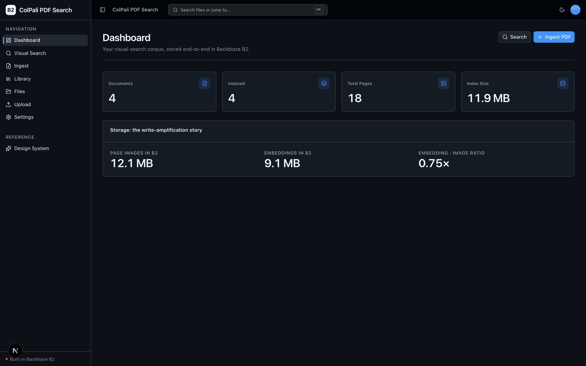
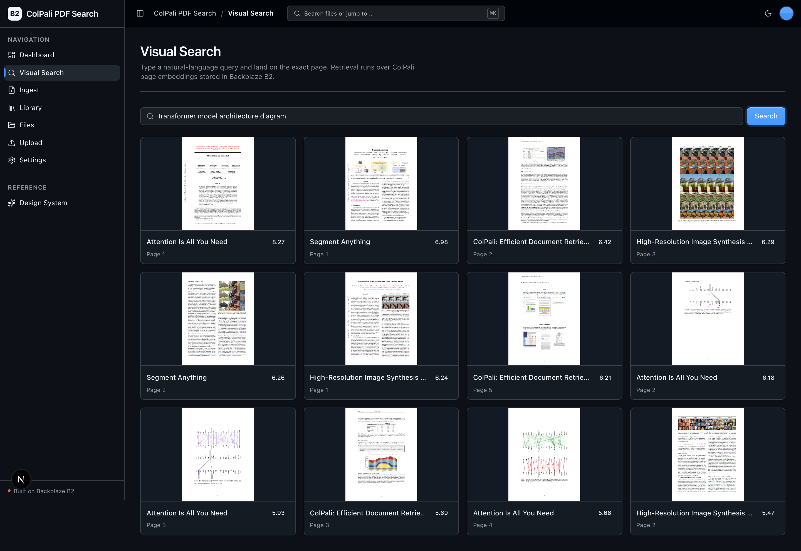
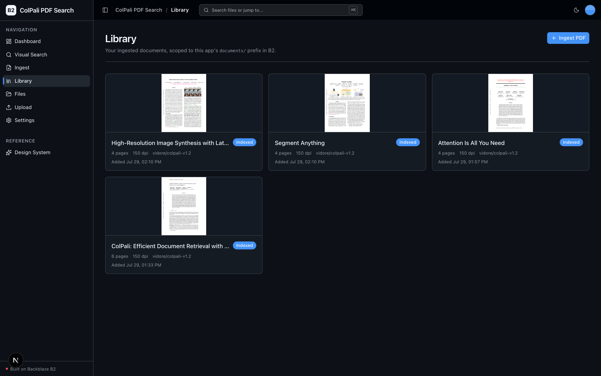
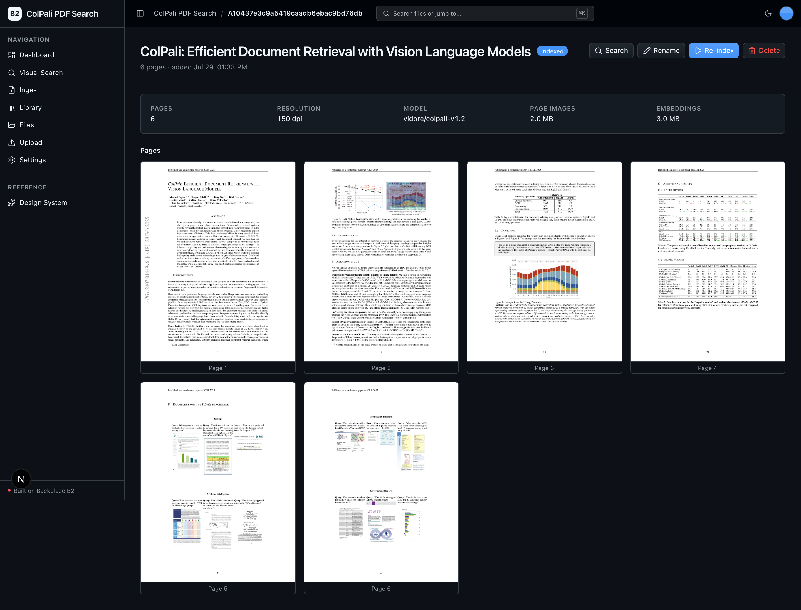
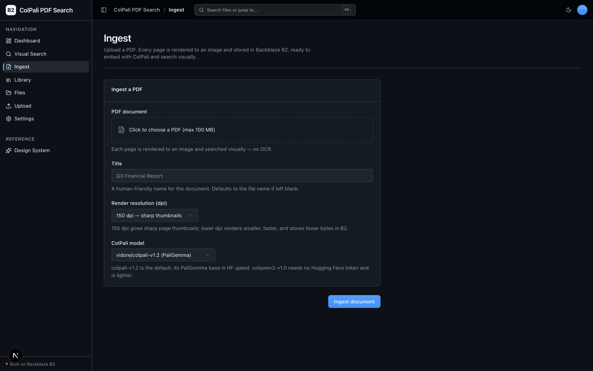

<!-- last_verified: 2026-07-29 -->
# ColPali PDF Search

Search a PDF corpus **visually**. ColPali PDF Search retrieves the right *page*
of your reports, decks, and scanned documents using vision embeddings (ColPali)
over rendered page images — **no OCR, no text extraction**. Type a
natural-language query ("show me the slide with the revenue waterfall chart")
and land on the exact page.

Every artifact lives in **[Backblaze B2](https://www.backblaze.com/sign-up/ai-cloud-storage?utm_source=github&utm_medium=referral&utm_campaign=ai_artifacts&utm_content=b2ai-colpali-pdf-search)**
over the S3-compatible API. The only credentials you need are `B2_*` — the
ColPali model runs locally, so there is no second provider key.

## What it looks like

**Dashboard** — corpus and storage stats, with the write-amplification headline putting page-image bytes next to embedding bytes and their ratio.



**Visual Search** — a natural-language query ("transformer model architecture diagram") ranks pages across the whole corpus by MaxSim relevance and streams each matching page image from B2 with its score.



**Library** — every ingested document as a card with its page-1 thumbnail, index status, page count, and ColPali model.



**Document detail** — one document's page images alongside its storage footprint (page images vs embeddings) and re-index / rename / delete actions.



**Ingest** — upload a PDF and pick the render dpi and ColPali model; each page is rendered to an image in B2, ready to embed.



## Why B2: write amplification

This is a storage-heavy workload by design. One PDF explodes into:

- **N page images** — every page rendered to a PNG
- **N per-page multi-vector embeddings** — ColPali late-interaction vectors that
  can rival or exceed the raw image footprint
- **one FAISS index** — built over all page-patch vectors across the corpus

All of it is written to, listed from, and streamed out of B2. The dashboard puts
the headline front and centre: page-image bytes vs embedding bytes, and the
embedding:image ratio. B2 is the single storage layer — there is no database.

## Features

- **Document ingest** — upload a PDF; each page is rendered to a PNG at a chosen
  dpi and stored under `pages/<id>/`
- **ColPali embedding + FAISS index** — embed each page into a multi-vector
  embedding (`embeddings/<id>/`), then build the FAISS index (`index/`)
- **Visual search** — embed a text query, MaxSim-rank pages, and stream the
  matching page images from B2 with relevance scores
- **Document library** — a scoped explorer over the app's `documents/` prefix
  (page count, status, page-1 thumbnail; rename / re-index / delete)
- **Full-bucket file browser** — the starter's `/files` view over every raw
  object (pages, embeddings, index) with preview / download / delete
- **Dashboard** — corpus + storage stats, including the write-amplification headline

## Tech Stack

- TypeScript, Next.js 16, React 19, Tailwind v4, shadcn/ui, TanStack Query
- Python 3.11+, FastAPI, boto3, Pydantic v2
- ColPali (`colpali-engine`), PyTorch, `transformers`, FAISS (`faiss-cpu`),
  PyMuPDF (`fitz`) — all local, no external provider
- Backblaze B2 (S3-compatible object storage)
- pnpm workspaces (monorepo)

## Quick Start

You need: Node.js >= 20, pnpm >= 9, Python >= 3.11, and a free
**[Backblaze B2 account](https://www.backblaze.com/sign-up/ai-cloud-storage?utm_source=github&utm_medium=referral&utm_campaign=ai_artifacts&utm_content=b2ai-colpali-pdf-search)**.
Local scripts are supported on macOS, Linux, and WSL2 (native Windows is not
supported — use WSL2).

**1. Run setup**

```bash
pnpm run setup
```

This copies `.env.example` to `.env` (only if missing), installs workspace
dependencies, creates `services/api/.venv`, and installs the API requirements.
The ML dependencies (torch, colpali-engine, faiss-cpu) are sizeable, and the
model weights download on first search/index — see the note below.

> Use the `pnpm run` form: `setup` and `doctor` are built-in pnpm commands
> before pnpm 11, so the bare forms would run pnpm's own commands.

**2. Add your B2 credentials**

Open `.env` and fill in the standard `B2_*` values from the
[Backblaze B2 dashboard](https://secure.backblaze.com/b2_buckets.htm?utm_source=github&utm_medium=referral&utm_campaign=ai_artifacts&utm_content=b2ai-colpali-pdf-search):

- **Bucket Unique Name** → `B2_BUCKET_NAME`
- The region segment of your bucket's S3 endpoint (e.g. `us-west-004` from
  `s3.us-west-004.backblazeb2.com`) → `B2_REGION`
- **keyID** → `B2_APPLICATION_KEY_ID`
- **applicationKey** → `B2_APPLICATION_KEY` *(shown once — paste it now)*

`B2_PUBLIC_URL_BASE` is optional (only used to build public object URLs for a
public bucket). The ColPali knobs are optional too: `COLPALI_MODEL`,
`COLPALI_DEVICE`, and `HF_TOKEN` (a one-time model-download token for the gated
PaliGemma base; the ungated `vidore/colqwen2-v1.0` model needs no token).

**3. Run it**

```bash
pnpm dev
```

Frontend at `localhost:3000`, API at `localhost:8000`. Ingest a short PDF, click
**Run indexing** on its detail page, then search from `/search`. Interactive API
docs are at `localhost:8000/docs`.

> **Model + device note.** ColPali runs locally. Device selection is runtime
> autodetect (CUDA → CPU; Apple MPS is skipped by default because PaliGemma float
> ops are unstable on MPS — set `COLPALI_DEVICE=mps` to force it). Weights are
> multi-GB and download once on first use, so use a tiny corpus (1–2 short PDFs)
> for a first run. The default model's PaliGemma base is HF-gated: a one-time
> free Hugging Face account + accepting the model terms is needed to download it,
> or switch to `vidore/colqwen2-v1.0`.

## Commands

| Command | What it does |
|---------|-------------|
| `pnpm run setup` | Copy `.env.example` to `.env` if missing, install deps, create the backend venv, install API requirements |
| `pnpm run doctor` | Preflight environment check (also runs before `pnpm dev`) |
| `pnpm dev` | Start frontend + backend |
| `pnpm dev:web` / `pnpm dev:api` | Frontend / backend only |
| `pnpm contract:export` | Export the deterministic FastAPI OpenAPI JSON |
| `pnpm contract:check` | Verify the OpenAPI artifact + frontend client route registry |
| `pnpm check:agent-docs` | Validate agent shims, command docs, CI claims, `.env` ignore coverage |
| `pnpm verify` | Canonical non-live pre-PR suite — `check:agent-docs`, then `verify:api`, then `verify:web` |
| `pnpm verify:api` | Backend half: API lint, tests, structure tests |
| `pnpm verify:web` | Frontend half: web lint, unit tests, typecheck + build |
| `pnpm verify:full` | `pnpm run doctor`, then `pnpm verify`, then Playwright E2E (needs a live local app) |
| `pnpm lint` / `pnpm lint:api` | Lint frontend / backend |
| `pnpm test:web` / `pnpm test:api` | Unit tests (vitest / pytest) |
| `pnpm check:structure` | Structural boundary tests |

Run `pnpm verify` before opening a PR (it needs `services/api/.venv` from setup).

## Documentation Map

| Doc | Purpose |
|-----|---------|
| [AGENTS.md](AGENTS.md) | Agent table of contents — start here |
| [ARCHITECTURE.md](ARCHITECTURE.md) | System layout, layering, data flows, B2 object layout |
| [docs/features/](docs/features/) | Feature docs (ingest, embedding, index, search, library, dashboard, file browser) |
| [docs/app-workflows.md](docs/app-workflows.md) | User journeys |
| [docs/dev-workflows.md](docs/dev-workflows.md) | Engineering workflows and testing |
| [docs/SECURITY.md](docs/SECURITY.md) | Security principles |
| [docs/RELIABILITY.md](docs/RELIABILITY.md) | Reliability expectations |

## License

MIT License — see [LICENSE](LICENSE) for details.
